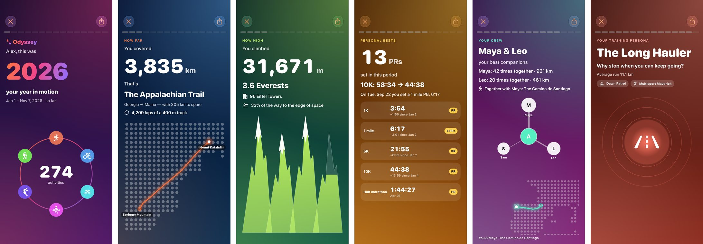
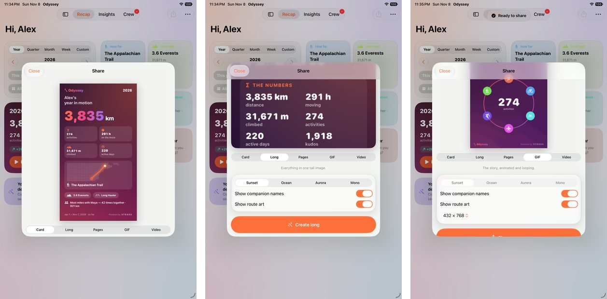
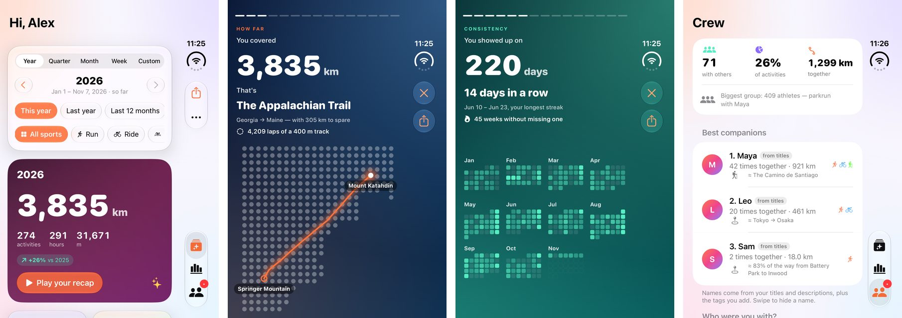
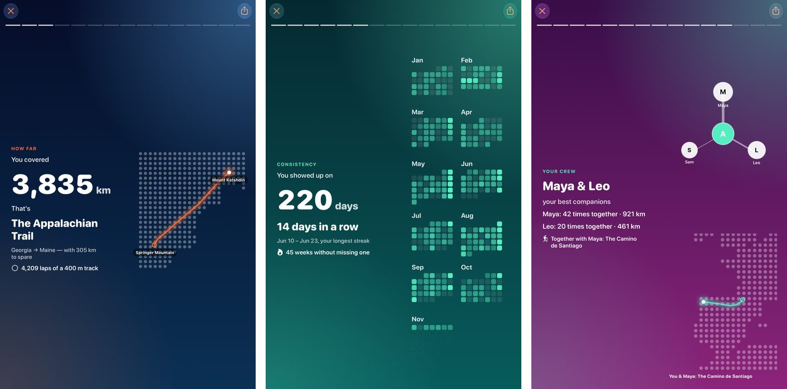

# Odyssey — your year in motion

An iOS 27 app (SwiftUI, Liquid Glass) that turns your Strava history into an
animated, shareable recap — for a year, or any quarter, month, week or custom
date range. Built for iPhone 18 / 18 Pro / Pro Max and iPhone Duo (outer and
inner displays, and half-folded).



<sub>Screenshots from CI with demo data: iPhone 18 Pro Max above; iPhone Duo's outer
display, the unfolded layout (iPad mini stand-in) and sharing below.</sub>

## What it shows

| Page | Example (demo data, 2026) |
|---|---|
| **The numbers** | 274 activities, 3,835 km, 291 hours, 31,671 m, 220 active days, +26% vs 2025 |
| **How far** | "The Appalachian Trail — with 305 km to spare", drawn on a dot-matrix world map; laps of a 400 m track; % of the way to the Moon |
| **How high** | "3.6 Everests", mountains filling up; Eiffel Towers; % of the way to space |
| **How long** | Days non-stop, football matches, films, Paris → New York flights, slices of pizza |
| **Consistency** | Calendar heatmap, longest daily streak, longest run of active weeks |
| **When** | 24-hour start-time clock, favourite weekday, earliest and latest starts |
| **Sport mix** | Donut by moving time |
| **Progress** | Volume per week/month, pace trend, "more ground per heartbeat", longest-run growth, vs the previous period |
| **Personal bests** | PRs from Strava best efforts: "5K 28:54 → 21:55", how many PRs |
| **Big moments** | "On Sun, Sep 27 you ran 42.2 km in 3:41:30", biggest climb, fastest run, most kudos… |
| **Your crew** | "Maya & Leo — 42 times together · 921 km", and how far that is together |
| **Your routes** | Route art: every route as a line drawing (no map, ends trimmed) |
| **Persona** | The Dawn Patrol, The Metronome, The Mountain Goat… with the evidence |

City pairs and Columbus's 1492 crossing (≈ 7,090 km via the Canaries) are
great-circle distances between their waypoints; trails and roads use their
commonly cited lengths (Silk Road ≈ 6,400 km, Route 66 ≈ 3,940 km,
Appalachian Trail ≈ 3,530 km). Every comparison is marked "≈".

## Sharing



**Share** (home toolbar, or the last story page) makes:

- **Card** — one 1080 × 1920 summary, story-sized
- **Long** — everything in one tall image
- **Pages** — every story page as its own 1080 × 1920 image
- **GIF** — the story, animated and looping (432 or 540 px wide)
- **Video** — 1080 × 1920 H.264, for Instagram/TikTok stories

Exports reuse the story's own views, rendered frame by frame from the same
0…1 animation clock, so a GIF frame looks exactly like the screen. Privacy
toggles hide companion names and route art.

## iPhone Duo and iPhone 18





- **Outer display (folded):** one story page at a time; the close / pause /
  share buttons are toolbar items, so iOS 27.1 moves them into the vertical
  side bar. Type and pictures scale to the shorter screen.
- **Inner display (unfolded):** each page becomes a spread — words on one side
  of the fold, the animated picture on the other — through `ArrangementView`,
  so nothing sits on the crease. Home, Insights and Crew switch to two columns.
- **Half-folded (tabletop):** picture above the hinge, words below
  (`onHingeChange`).
- **Folding mid-story** keeps your page: the story position lives in the app
  model, not the view.
- **iPhone 18 Pro / Pro Max in landscape** get the same spread layout.

## Get your own data in

1. Go to [strava.com/settings/api](https://www.strava.com/settings/api) and
   create an app (any name, any website, category of your choice). Strava
   requires a Strava subscription to create one.
2. Set **Authorization Callback Domain** to `localhost`.
3. In Odyssey: **Settings → Strava API app**, paste the **Client ID** and
   **Client Secret**, then tap **Connect with Strava**. If the Strava app is
   installed you can approve there instead.

The secret is stored in the Keychain on your phone. To give Odyssey to others
without sharing the secret, deploy the [token server](backend/README.md) and
enter its URL instead.

Good to know:

- New Strava API apps start in **single-player mode**: only your own account
  can connect — fine for testing with your own data. Strava's API settings
  let you raise that to 10 athletes; beyond that, Strava reviews the app.
- Strava allows **100 reads per 15 minutes and 1,000 a day** per app. Odyssey
  fetches activity lists for the range you're looking at (and the period
  before it, for comparisons), caches them, and then spends a small budget on
  per-activity details for PBs and crew names. It reads the rate-limit
  headers, pauses when close, and resumes by itself.
- **Companions:** Strava's API says how many athletes were on a group
  activity, but not who. Odyssey reads names from your titles and
  descriptions ("Long run with Maya & Leo", "w/ @sam") and lets you tag the
  rest in the **Crew** tab. Tags stay on the device.
- Activity data is stored only on the device (Application Support, file
  protection on). Nothing is uploaded.
- No account yet? **Explore with demo data** shows a full fictional year.

## Building

```bash
brew install xcodegen
cd Odyssey
xcodegen generate
open Odyssey.xcodeproj        # Xcode 27.1+, iOS 27 SDK
```

Core logic tests (analytics, Strava client, equivalents, demo data) run
anywhere Swift 6.2+ runs, including Linux:

```bash
swift test --package-path Odyssey/Packages/OdysseyKit
```

CI (`.github/workflows/odyssey.yml`) builds on the `xcode-27` runner and
uploads screenshots of every screen and story page from the iPhone 18 Pro,
18 Pro Max, iPhone Duo (folded) and iPad mini simulators. iPad mini stands
in for the Duo's unfolded inner display, which CI can't unfold.

### TestFlight

`.github/workflows/odyssey-testflight.yml` signs and uploads a build using the
same secrets as Snag (see [docs/TESTFLIGHT.md](../docs/TESTFLIGHT.md)); register
the bundle ID `com.oftenunknown.odyssey` (or set `ODYSSEY_BUNDLE_ID`; no
capabilities needed) and create its App Store Connect record first. The team
also needs at least one registered iPhone: Xcode signs the archive for
development before re-signing it for the App Store. Optional repository
variables `STRAVA_CLIENT_ID` and `ODYSSEY_TOKEN_SERVER` are baked into the
build; with both set, testers can connect without typing anything. Push a tag
like `odyssey-testflight-1` to run it (the Actions tab only offers **Run
workflow** once this file is on the default branch).

## Layout

```
App/                      iOS app (SwiftUI)
  Core/                   App model (state, sync, recap), settings, Keychain/JSON storage
  Layout/                 Root tabs, iPhone Duo support (hinge, side bar, fold-aware split)
  Features/Story/         Story player and the 15 pages
  Features/Visuals/       Dot-matrix journey map, track, mountains, heatmap, clock, route art
  Features/Share/         Export compositions; PNG, GIF (ImageIO) and MP4 (AVAssetWriter)
  Features/…              Recap home, Insights, Crew, Settings, Connect
Packages/OdysseyKit/      Platform-independent: Strava API + OAuth, sync planning,
                          recap analytics, equivalents, world land mask, demo data (+48 tests)
UITests/                  Screenshot tour run in CI
backend/                  Optional Cloudflare Worker that holds the Strava client secret
```

## Next steps

- Apple Health (Apple Watch workouts) as a second source via HealthKit —
  the recap engine works on a provider-neutral `Activity` model.
- Garmin Connect and other providers through their APIs.
- Reverse-geocode "furthest adventure" and home on device for place names.
